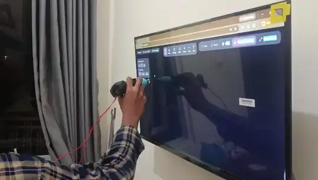

<p align="center">
  
</p>

---

**Papan Tulis Interaktif Berdaya AI yang Benar-Benar Terjangkau dan Mudah Diadakan (*Obtainable*) untuk Ruang Kelas 3T.**

Smartboard komersial seharga Rp30–60 juta per unit sulit diadakan oleh sekolah di daerah 3T dan sekolah negeri berpagu minim. Di sisi lain, solusi pembelajaran digital berbasis aplikasi sering menuntut setiap siswa membawa smartphone atau tablet pribadi ke kelas.

**SPIDOL** (*Sistem Pena Interaktif Deteksi Optik & Low-Cost*) dirancang dengan prinsip keterjangkauan nyata (*obtainability*):

- **Mudah diadakan.** Spidol dimodifikasi dengan komponen elektronik umum yang tersedia di pasaran lokal, dengan total biaya perangkat keras **di bawah Rp150.000**.
- **Tanpa pengadaan layar baru.** Cukup memanfaatkan papan tulis dan proyektor atau layar (termasuk TV biasa) yang sudah ada di kelas.
- **Tanpa beban gawai siswa.** Seluruh siswa belajar bersama dari layar yang sama, tanpa diwajibkan membawa smartphone atau laptop.
- **Irit bandwidth.** Menulis dan melacak spidol berjalan lokal di laptop guru. Internet hanya dibutuhkan sesaat untuk mengirim potongan gambar saat tombol *Analyze drawing* ditekan.

Yang diasumsikan sudah tersedia: satu laptop untuk guru, satu kamera (ponsel atau webcam), serta papan tulis dan proyektor atau layar.

Dengan kemudahan pengadaan ini, papan interaktif berbasis AI berpeluang dihadirkan untuk banyak siswa di sekolah pelosok yang selama ini belum terjangkau smartboard.

<p align="center">
  
</p>

<p align="center"><em>Contoh: integral tentu ditulis tangan di kanvas, lalu <b>Analyze drawing</b> menampilkan grafiknya lengkap dengan area berarsir dan nilai integral (6,17), serta slider untuk menelusuri kurva.</em></p>

### Mengapa SPIDOL Lebih Mudah Diadakan di Kelas 3T?

| Aspek pengadaan | Smartboard komersial / aplikasi web | **Pendekatan SPIDOL** |
|---|---|---|
| **Biaya perangkat** | Rp30.000.000 – Rp60.000.000 per unit. | **Di bawah Rp150.000** (komponen elektronik umum di pasaran lokal). |
| **Kebutuhan gawai siswa** | Aplikasi umumnya menuntut tiap siswa memiliki smartphone atau tablet. | **Nol perangkat di sisi siswa:** satu spidol untuk satu ruang kelas. |
| **Pemanfaatan sarana kelas** | Harus membeli dan memasang papan atau layar baru. | **Memakai fasilitas yang ada:** papan tulis dan proyektor atau layar yang sudah tersedia. |
| **Kebutuhan bandwidth** | Streaming video atau aplikasi web umumnya boros kuota. | **Local-first dan AI on-demand:** kanvas berjalan lokal; internet hanya dipakai saat memanggil AI untuk membaca rumus. |

## Daftar Isi

- [Apa yang Dilakukan SPIDOL](#apa-yang-dilakukan-spidol)
  - [Cara kerja](#cara-kerja)
  - [Demonstrasi goresan](#demonstrasi-goresan)
- [Struktur Repositori](#struktur-repositori)
- [Daftar Komponen (BOM)](#daftar-komponen-bom)
- [Cara Menjalankan](#cara-menjalankan)
  - [1. Coba tanpa perangkat keras](#1-coba-tanpa-perangkat-keras-mouse-menggantikan-spidol)
  - [2. Siapkan kunci API AI](#2-siapkan-kunci-api-ai-diperlukan-untuk-analyze-drawing)
  - [3. Dengan kamera dan spidol fisik](#3-dengan-kamera-dan-spidol-fisik)
  - [4. Mode produksi](#4-mode-produksi-demonstrasi)
  - [5. Mengunggah firmware ke ESP32](#5-mengunggah-firmware-ke-esp32)
  - [Menjalankan tes](#menjalankan-tes)
- [Cakupan Versi Ini](#cakupan-versi-ini)
- [Manfaat](#manfaat)
- [Dokumentasi Lanjutan](#dokumentasi-lanjutan)

## Apa yang Dilakukan SPIDOL

1. **Spidol menjadi mouse di papan tulis.** Kamera melacak ujung spidol yang berwarna mencolok, dan posisinya menjadi posisi kursor. Sensor sentuh kapasitif di ujung spidol mendeteksi saat spidol menempel ke papan, dan sentuhan itu menjadi klik kiri.
2. **Tulisan langsung menjadi garis digital.** Kanvas web menggambar garis tepat di bawah ujung spidol dan ditampilkan kembali lewat proyektor atau layar yang tersambung ke laptop. Tersedia pilihan warna, ketebalan garis, undo/redo, dan Kiosk Mode untuk presentasi.
3. **AI membaca rumus dan menampilkan grafiknya.** Setelah menulis rumus, guru mengklik tombol *Analyze drawing* di layar dengan spidol yang sama. Model vision (default: Gemini) membaca tulisan tangan, lalu grafik fungsi yang akurat muncul di samping tulisan, lengkap dengan parameter yang bisa digeser. Mendukung grafik fungsi `y = f(x)`, kurva parametrik (mis. lingkaran), dan integral tentu.

Spidol tidak punya tombol tambahan karena seluruh fitur dioperasikan lewat posisi dan sentuhan.

### Cara kerja


Firmware hanya mengirim status sentuh; posisi sepenuhnya berasal dari kamera. Menulis, menggambar, dan menampilkan grafik berjalan lokal di laptop. Internet hanya dipakai saat AI diminta membaca rumus.

**Fitur teknis utama** (penjelasan lengkap, lengkap dengan alasan desain, ada di [`docs/TEKNIS.md`](./docs/TEKNIS.md)):

| Fitur | Cara kerja singkat |
|---|---|
| **Pelacakan posisi** | Ambang warna HSV yang disetel dari foto spidol asli, mask poligon area pencarian, kontur terbesar, dan centroid dari image moments. Saturasi minimum dinaikkan untuk menolak false positive dari layar TV ([bagian 2](./docs/TEKNIS.md#2-pelacakan-posisi-ujung-spidol)) |
| **Anti-jitter** | *Exponential moving average* (`alpha` 0,3) sebagai decorator; status direset saat pelacakan hilang agar tidak ada tarikan ke posisi lama ([bagian 3](./docs/TEKNIS.md#3-peredam-jitter-anti-jitter)) |
| **Proyeksi frame ke layar** | Empat sudut area yang diseret pada tayangan kamera menjadi korespondensi homography (`cv2.findHomography`) ke sudut layar, sehingga kamera boleh miring dan layar boleh trapesium ([bagian 4](./docs/TEKNIS.md#4-proyeksi-frame-kamera-ke-layar)) |
| **Jembatan kehilangan pelacakan** | Celah deteksi di bawah 150 ms (misalnya tertutup tangan) diisi dengan interpolasi linier; celah lebih panjang menjadi pen-up ([bagian 5](./docs/TEKNIS.md#5-penanganan-kehilangan-pelacakan)) |
| **Sentuh dan kontrol kursor** | Sinyal sentuh kapasitif lewat BLE GATT atau WiFi TCP, diubah menjadi klik kiri OS; posisi spidol menggerakkan kursor sistem ([bagian 6](./docs/TEKNIS.md#6-sinyal-sentuh-dan-kontrol-kursor)) |
| **Penghalusan garis** | Kurva kuadratik melalui titik tengah untuk goresan bebas; bentuk geometris tetap tegas; undo/redo berbasis gestur ([bagian 8](./docs/TEKNIS.md#8-rendering-goresan)) |
| **Pipeline AI** | Region goresan dihitung di server, di-crop dengan margin, dikirim ke model vision (kompatibel OpenAI), keluaran divalidasi Pydantic ([bagian 9](./docs/TEKNIS.md#9-pipeline-ai)) |
| **Mesin grafik** | Evaluasi aman lewat mathjs (tanpa `eval`), kurva eksplisit, integral tentu dengan aturan trapesium, pan/zoom, dan sumbu "rapi" ([bagian 10](./docs/TEKNIS.md#10-mesin-grafik-fungsi)) |

### Demonstrasi goresan

<p align="center">
  
</p>

<p align="center"><em>Menulis langsung dengan spidol SPIDOL: posisi ujung spidol menjadi kursor dan sentuhan menjadi klik, sehingga garis tergambar di kanvas tepat di bawah ujung spidol. Demonstrasi ini memakai TV biasa (bukan smart TV) yang disambungkan ke laptop yang menjalankan server. Karena tampilannya dikirim dari laptop, perangkat apa pun yang dapat menampilkan gambar dari laptop, seperti proyektor, TV, atau monitor, dapat dipakai.</em></p>

<!-- TODO gambar: foto spidol yang dibongkar (sensor kapasitif + ESP32) dan foto rangkaian akhir. -->

## Struktur Repositori

```
spidol-project/
├── spidol/   Firmware ESP32 pada badan spidol (C++/PlatformIO; BLE atau WiFi/TCP)
├── server/   Inti sistem (Python): kamera, pelacak warna, homography, WebSocket, pipeline AI
│   ├── hal/       Pelacak posisi dan penyedia sinyal sentuh yang dapat ditukar
│   ├── vision/    Homography, area pelacakan, deteksi kontur, penanganan kehilangan pelacakan
│   ├── ai/        Potong area coretan -> model vision -> jenis tampilan + parameter
│   └── tests/     Uji otomatis server
├── view/     Papan tulis digital yang diproyeksikan (React + Vite)
└── docs/     Catatan keputusan arsitektur (ADR) dan spesifikasi fitur
```

- **`spidol/`**: terhubung ke server dan mengirim status "menyentuh/tidak". Tidak mengirim posisi.
- **`server/`**: membuka kamera, melacak ujung spidol, mengoreksi perspektif, menggabungkan posisi dan sentuhan, menyiarkan ke browser lewat WebSocket, dan memanggil model AI.
- **`view/`**: kanvas, antarmuka, dan widget grafik fungsi.

## Daftar Komponen (BOM)

Total di bawah Rp150.000 (dua toko resmi di Tokopedia):

- ESP32 standar (varian dengan WiFi dan Bluetooth)
- Baterai Li-ion 18650 + modul charger TP4056
- Sensor sentuh kapasitif dengan perpanjangan *patch* konduktif (*capacitive patch extension*) di ujung spidol

Rangkaian akhir dirakit tanpa breadboard. Kamera memakai ponsel atau webcam yang sudah dimiliki; layar atau proyektor dan permukaannya (papan tulis atau TV) dapat memakai yang sudah ada.

<!-- TODO: lengkapi dengan harga per item dan komponen pendukung lain yang masih dipakai. -->

## Cara Menjalankan

**Syarat:** Python 3.10+, Node.js dengan pnpm, dan (opsional, hanya untuk spidol fisik) PlatformIO.

### 1. Coba tanpa perangkat keras (mouse menggantikan spidol)

```bash
# Terminal 1: server Python
cd server
python -m venv .venv
.venv\Scripts\activate        # Linux/Mac: source .venv/bin/activate
pip install -r requirements.txt
python main.py --dev

# Terminal 2: frontend React
cd view
pnpm install
pnpm run dev
```

Buka `http://localhost:5173`. Klik kiri dan tahan untuk menggambar; fitur ini langsung berfungsi tanpa kunci API. Tombol *Analyze drawing* memerlukan kunci API AI; tanpa kunci hanya muncul peringatan (lihat langkah 2).

### 2. Siapkan kunci API AI (diperlukan untuk Analyze drawing)

Fitur *Analyze drawing* membutuhkan kunci API model vision. Salin `server/.env.example` menjadi `server/.env`, lalu isi `AI_API_KEY` (Gemini). Untuk penyedia lain yang kompatibel OpenAI (mis. OpenRouter), isi juga `AI_BASE_URL` dan `AI_MODEL`. Batas waktu panggilan default 3 detik dan dapat diubah dengan `AI_TIMEOUT_S`. Tanpa kunci, *Analyze drawing* hanya menampilkan peringatan (*alert*) dan tidak membaca rumus. Fitur menulis dan menggambar tidak memerlukan kunci ini.

### 3. Dengan kamera dan spidol fisik

Preset di [`server/run.py`](./server/run.py) menyingkat opsi yang panjang:

```bash
cd server
python run.py                  # daftar preset
python run.py pc-camera        # webcam PC, kursor OS mengikuti spidol
python run.py adjust-region    # kamera ponsel, atur area deteksi lebih dulu
```

Preset dengan `--control-os-cursor` membuat posisi spidol menggerakkan kursor sistem dan sentuhan menjadi klik kiri.

#### Alur jendela kamera saat start

Saat server dijalankan dengan kamera (preset `adjust-region`, atau opsi `--adjust-tracking-region` pada preset lain), dua jendela OpenCV muncul berurutan:

1. **Jendela pemilihan frame** (*SPIDOL - Adjust Tracking Region*). Menampilkan tayangan langsung kamera dengan bingkai empat sudut berwarna kuning. Geser keempat sudutnya hingga pas dengan tepi layar atau area proyeksi. Bingkai ini punya dua fungsi:
   - Pelacak hanya mencari ujung spidol di dalam bingkai, sehingga benda berwarna serupa di luar papan tidak mengganggu.
   - Keempat sudut menjadi batas layar: sudut kiri atas bingkai sama dengan sudut kiri atas layar, dan seterusnya. Dengan begitu posisi ujung spidol di dalam bingkai dipetakan ke posisi kursor mouse Windows (bila `--control-os-cursor` aktif) dan ke kanvas.
2. **Tekan Enter** (atau Space) untuk mengunci bingkai. Esc mengembalikan keempat sudut ke posisi awal. Menekan Enter tanpa menggeser apa pun, atau menutup jendela tanpa konfirmasi, berarti seluruh frame kamera dipakai.
3. **Jendela deteksi objek** (*SPIDOL Camera Debug*) muncul setelah jendela pertama tertutup. Jendela ini menampilkan tayangan kamera dengan tanda silang hijau dan label `DETECTED` di ujung spidol, atau label merah `NO TARGET` bila ujung spidol tidak terlihat. Gunakan untuk memastikan kamera mengenali warna ujung spidol sebelum mulai menulis. Jendela ini aktif lewat opsi `--debug-camera`, yang sudah termasuk di preset di atas.

Pengaturan bingkai dilakukan sekali setiap kali server dijalankan dan tidak disimpan ke disk. Ulangi bila posisi kamera bergeser.

### 4. Mode produksi (demonstrasi)

```bash
cd view && pnpm run build
cd ../server && .venv\Scripts\activate
python main.py
```

Satu proses melayani WebSocket, deteksi kamera, dan frontend hasil build di `http://localhost:5000`.

### 5. Mengunggah firmware ke ESP32

Isi nama dan kata sandi WiFi di firmware sebelum mengunggah. Jangan menyimpan kredensial asli di repositori publik.

```bash
cd spidol
pio run --target upload
pio device monitor
```

Firmware punya dua varian koneksi: BLE (opsi `--ble-address` pada server) atau WiFi/TCP (opsi `--wifi-touch-port`).

### Menjalankan tes

```bash
cd server && pytest            # tes Python
cd view && pnpm test           # tes frontend
```

## Cakupan Versi Ini

- Menampilkan grafik fungsi yang akurat. Simulasi fisika (pegas-massa, bandul, gerak peluru) menyusul; fondasinya (jenis simulasi dan klasifikasi oleh AI) sudah disiapkan.
- Satu spidol per sesi ([ADR-0004](./docs/adr/0004-v1-scope-single-stylus-no-aruco.md)).
- Kalibrasi perspektif kamera dilakukan sekali per sesi dengan menyeret empat sudut area proyeksi.
- Pengenalan rumus oleh AI memerlukan internet; fitur lainnya berjalan lokal.

## Manfaat

SPIDOL dirancang untuk kelas yang sudah punya papan tulis dengan proyektor, atau TV, tetapi tidak punya smartboard: pelajar SD–SMA di daerah 3T yang terkendala akses perangkat digital dan internet, dan membutuhkan pembelajaran luring serta materi yang terjangkau. Idenya bukan menambah perangkat baru ke kelas, melainkan membuat perangkat yang sudah ada mampu berbuat lebih banyak.

- **Terjangkau.** Komponen spidol di bawah Rp150.000, dibanding Rp30–60 juta untuk smartboard komersial. Layar yang sudah ada (proyektor, TV biasa, atau monitor yang bisa tersambung ke laptop) dan kamera (ponsel atau webcam) tetap dipakai, tanpa membeli smartboard atau smart TV.
- **Local-first, berjalan luring.** Menulis, menggambar, melacak spidol, dan menghitung kurva berlangsung sepenuhnya di laptop. Internet dan kunci API hanya dibutuhkan saat AI diminta membaca rumus lewat *Analyze drawing*; bila koneksi terputus, jawaban cadangan (*Cached Fallback Schema*) ditampilkan.
- **Satu perangkat untuk satu kelas.** Siswa tidak membutuhkan gawai masing-masing; seluruh kelas belajar dari layar yang sama.
- **Materi dibuat di tempat.** Guru menulis rumus dengan tulisan tangannya sendiri, dan grafik langsung muncul. Tidak perlu menyiapkan slide atau membagikan berkas materi sebelumnya.
- **Konsep abstrak menjadi terlihat.** Parameter fungsi dapat digeser langsung di papan, sehingga siswa melihat sendiri bagaimana perubahan nilai mengubah bentuk kurva.
- **Mudah dipasang.** Tidak ada instalasi permanen pada papan; cukup pasang kamera, atur empat sudut area proyeksi satu kali per sesi, dan mulai menulis.
- **Kendali tetap di tangan guru.** AI hanya bekerja saat tombol *Analyze drawing* diklik, dan grafik tampil di samping tulisan aslinya sehingga mudah dicocokkan.
- **Inklusivitas kinestetik dan visual (merangkul siswa yang tertinggal).** Siswa yang kesulitan memahami sains dan matematika sering terhambat karena rumus diajarkan secara abstrak dan kaku. SPIDOL dirancang agar konsep abstrak menjadi konkret dan bisa dijamah secara fisik: siswa diajak maju ke depan kelas, menyentuh dan menggeser slider kurva langsung di layar, dan mengamati hubungan sebab-akibat dari perubahan parameter rumus secara visual dan real-time.
- **Efisiensi kuota data untuk sekolah pelosok.** Berbeda dengan aplikasi video atau streaming kelas yang memakan kuota besar, SPIDOL memproses seluruh coretan dan kalkulasi kurva secara lokal di laptop. Koneksi internet hanya dibutuhkan sesaat untuk mengirim potongan gambar rumus saat tombol *Analyze drawing* ditekan (on-demand), sehingga hemat bandwidth.
- **Mudah dikembangkan.** Firmware, server, dan antarmuka dipisahkan; penyedia AI dapat diganti; dan fondasi simulasi fisika sudah disiapkan untuk pengembangan berikutnya.

## Dokumentasi Lanjutan

- [`docs/TEKNIS.md`](./docs/TEKNIS.md): penjelasan teknis mendalam (pelacakan, anti-jitter, homography, telemetri, rendering, pipeline AI, mesin grafik)
- [`SPEC.md`](./SPEC.md): spesifikasi teknis dan arsitektur
- [`GLOSSARY.md`](./GLOSSARY.md): istilah baku proyek
- [`docs/adr/`](./docs/adr/): catatan keputusan arsitektur beserta alasannya
- [`docs/specs/`](./docs/specs/): spesifikasi fitur
