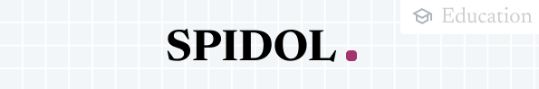
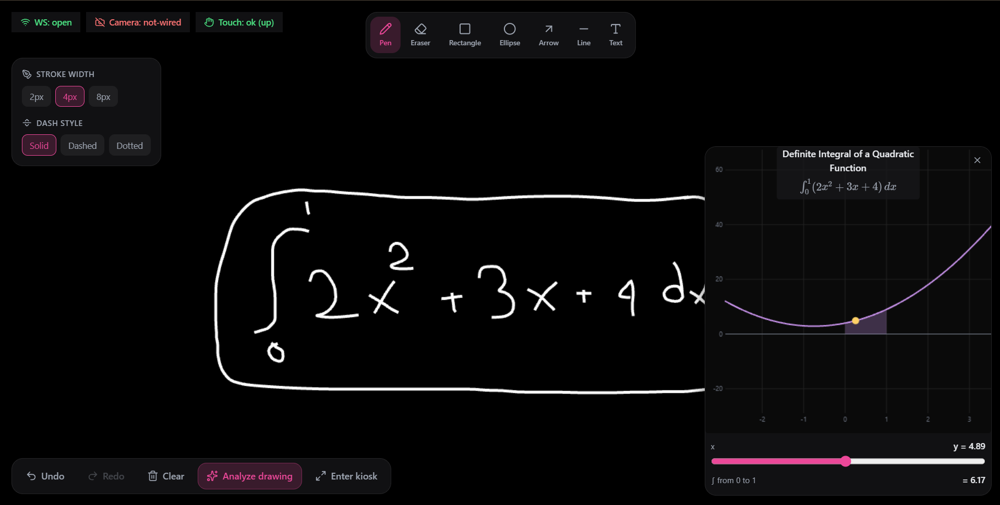
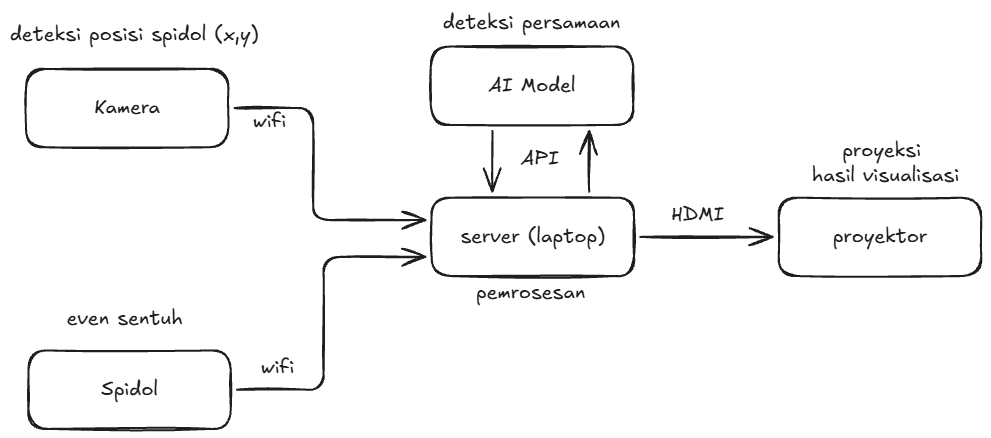

<p align="center">
  
</p>

# SPIDOL

Papan tulis interaktif berbiaya rendah. SPIDOL mengubah papan tulis dan proyektor kelas biasa menjadi papan tulis interaktif dengan satu spidol yang dimodifikasi. Komponen spidolnya berbiaya di bawah Rp150.000, dibanding Rp30–60 juta untuk smartboard komersial.

<p align="center">
  
</p>

<p align="center"><em>Contoh: integral tentu ditulis tangan di kanvas, lalu <b>Analyze drawing</b> menampilkan grafiknya lengkap dengan area berarsir dan nilai integral (6,17), serta slider untuk menelusuri kurva.</em></p>

<!-- TODO gambar: foto/GIF penggunaan nyata di whiteboard dengan proyektor menyala (opsional, melengkapi tangkapan layar di atas). -->

## Daftar Isi

- [Apa yang Dilakukan SPIDOL](#apa-yang-dilakukan-spidol)
  - [Cara kerja](#cara-kerja)
- [Struktur Repositori](#struktur-repositori)
- [Daftar Komponen (BOM)](#daftar-komponen-bom)
- [Cara Menjalankan](#cara-menjalankan)
  - [1. Coba tanpa perangkat keras](#1-coba-tanpa-perangkat-keras-mouse-menggantikan-spidol)
  - [2. Aktifkan AI (opsional)](#2-aktifkan-ai-opsional)
  - [3. Dengan kamera dan spidol fisik](#3-dengan-kamera-dan-spidol-fisik)
  - [4. Mode produksi](#4-mode-produksi-demonstrasi)
  - [5. Mengunggah firmware ke ESP32](#5-mengunggah-firmware-ke-esp32)
  - [Menjalankan tes](#menjalankan-tes)
- [Cakupan Versi Ini](#cakupan-versi-ini)
- [Manfaat](#manfaat)
- [Dokumentasi Lanjutan](#dokumentasi-lanjutan)

## Apa yang Dilakukan SPIDOL

1. **Spidol menjadi mouse di papan tulis.** Kamera melacak ujung spidol yang berwarna mencolok, dan posisinya menjadi posisi kursor. Sensor sentuh kapasitif di ujung spidol mendeteksi saat spidol menempel ke papan, dan sentuhan itu menjadi klik kiri.
2. **Tulisan langsung menjadi garis digital.** Kanvas web menggambar garis tepat di bawah ujung spidol dan diproyeksikan kembali ke papan. Tersedia pilihan warna, ketebalan garis, undo/redo, dan Kiosk Mode untuk presentasi.
3. **AI membaca rumus dan menampilkan grafiknya.** Setelah menulis rumus, guru mengklik tombol *Analyze drawing* di layar dengan spidol yang sama. Model vision (default: Gemini) membaca tulisan tangan, lalu grafik fungsi yang akurat muncul di samping tulisan, lengkap dengan parameter yang bisa digeser. Mendukung grafik fungsi `y = f(x)`, kurva parametrik (mis. lingkaran), dan integral tentu.

Spidol tidak punya tombol tambahan karena seluruh fitur dioperasikan lewat posisi dan sentuhan.

### Cara kerja



Firmware hanya mengirim status sentuh; posisi sepenuhnya berasal dari kamera. Menulis, menggambar, dan menampilkan grafik berjalan lokal di laptop. Internet hanya dipakai saat AI diminta membaca rumus.

<!-- TODO gambar: foto spidol yang dibongkar (sensor kapasitif + ESP32) dan foto rangkaian akhir. -->

## Struktur Repositori

```
spidol-project/
├── spidol/   Firmware ESP32 pada badan spidol (C++/PlatformIO; BLE atau WiFi/TCP)
├── server/   Inti sistem (Python): kamera, pelacak warna, homography, WebSocket, pipeline AI
│   ├── hal/       Pelacak posisi dan penyedia sinyal sentuh yang dapat ditukar
│   ├── vision/    Homography, area pelacakan, deteksi kontur, penanganan kehilangan pelacakan
│   ├── ai/        Potong area coretan -> model vision -> jenis tampilan + parameter
│   └── tests/     Uji otomatis server
├── view/     Papan tulis digital yang diproyeksikan (React + Vite)
└── docs/     Catatan keputusan arsitektur (ADR) dan spesifikasi fitur
```

- **`spidol/`**: terhubung ke server dan mengirim status "menyentuh/tidak". Tidak mengirim posisi.
- **`server/`**: membuka kamera, melacak ujung spidol, mengoreksi perspektif, menggabungkan posisi dan sentuhan, menyiarkan ke browser lewat WebSocket, dan memanggil model AI.
- **`view/`**: kanvas, antarmuka, dan widget grafik fungsi.

## Daftar Komponen (BOM)

Total di bawah Rp150.000 (dua toko resmi di Tokopedia):

- ESP32 standar (varian dengan WiFi dan Bluetooth)
- Baterai Li-ion 18650 + modul charger TP4056
- Sensor sentuh kapasitif dengan perpanjangan *patch* konduktif (*capacitive patch extension*) di ujung spidol

Rangkaian akhir dirakit tanpa breadboard. Kamera memakai ponsel atau webcam yang sudah dimiliki; proyektor dan papan tulis milik kelas.

<!-- TODO: lengkapi dengan harga per item dan komponen pendukung lain yang masih dipakai. -->

## Cara Menjalankan

**Syarat:** Python 3.10+, Node.js dengan pnpm, dan (opsional, hanya untuk spidol fisik) PlatformIO.

### 1. Coba tanpa perangkat keras (mouse menggantikan spidol)

```bash
# Terminal 1: server Python
cd server
python -m venv .venv
.venv\Scripts\activate        # Linux/Mac: source .venv/bin/activate
pip install -r requirements.txt
python main.py --dev

# Terminal 2: frontend React
cd view
pnpm install
pnpm run dev
```

Buka `http://localhost:5173`. Klik kiri dan tahan untuk menggambar. Tombol *Analyze drawing* memberi hasil untuk rumus demonstrasi walau kunci API belum diisi.

### 2. Aktifkan AI (opsional)

Salin `server/.env.example` menjadi `server/.env`, lalu isi `AI_API_KEY` (Gemini). Untuk penyedia lain yang kompatibel OpenAI (mis. OpenRouter), isi juga `AI_BASE_URL` dan `AI_MODEL`. Jika kunci kosong, pemanggilan gagal, atau melebihi batas waktu (default 3 detik, atur dengan `AI_TIMEOUT_S`), sistem menampilkan jawaban cadangan untuk rumus demonstrasi.

### 3. Dengan kamera dan spidol fisik

Preset di [`server/run.py`](./server/run.py) menyingkat opsi yang panjang:

```bash
cd server
python run.py                  # daftar preset
python run.py pc-camera        # webcam PC, kursor OS mengikuti spidol
python run.py adjust-region    # kamera ponsel, atur area deteksi lebih dulu
```

Preset dengan `--control-os-cursor` membuat posisi spidol menggerakkan kursor sistem dan sentuhan menjadi klik kiri.

#### Alur jendela kamera saat start

Saat server dijalankan dengan kamera (preset `adjust-region`, atau opsi `--adjust-tracking-region` pada preset lain), dua jendela OpenCV muncul berurutan:

1. **Jendela pemilihan frame** (*SPIDOL - Adjust Tracking Region*). Menampilkan tayangan langsung kamera dengan bingkai empat sudut berwarna kuning. Geser keempat sudutnya hingga pas dengan tepi papan tulis atau area proyeksi. Bingkai ini punya dua fungsi:
   - Pelacak hanya mencari ujung spidol di dalam bingkai, sehingga benda berwarna serupa di luar papan tidak mengganggu.
   - Keempat sudut menjadi batas layar: sudut kiri atas bingkai sama dengan sudut kiri atas layar, dan seterusnya. Dengan begitu posisi ujung spidol di dalam bingkai dipetakan ke posisi kursor mouse Windows (bila `--control-os-cursor` aktif) dan ke kanvas.
2. **Tekan Enter** (atau Space) untuk mengunci bingkai. Esc mengembalikan keempat sudut ke posisi awal. Menekan Enter tanpa menggeser apa pun, atau menutup jendela tanpa konfirmasi, berarti seluruh frame kamera dipakai.
3. **Jendela deteksi objek** (*SPIDOL Camera Debug*) muncul setelah jendela pertama tertutup. Jendela ini menampilkan tayangan kamera dengan tanda silang hijau dan label `DETECTED` di ujung spidol, atau label merah `NO TARGET` bila ujung spidol tidak terlihat. Gunakan untuk memastikan kamera mengenali warna ujung spidol sebelum mulai menulis. Jendela ini aktif lewat opsi `--debug-camera`, yang sudah termasuk di preset di atas.

Pengaturan bingkai dilakukan sekali setiap kali server dijalankan dan tidak disimpan ke disk. Ulangi bila posisi kamera bergeser.

### 4. Mode produksi (demonstrasi)

```bash
cd view && pnpm run build
cd ../server && .venv\Scripts\activate
python main.py
```

Satu proses melayani WebSocket, deteksi kamera, dan frontend hasil build di `http://localhost:5000`.

### 5. Mengunggah firmware ke ESP32

Isi nama dan kata sandi WiFi di firmware sebelum mengunggah. Jangan menyimpan kredensial asli di repositori publik.

```bash
cd spidol
pio run --target upload
pio device monitor
```

Firmware punya dua varian koneksi: BLE (opsi `--ble-address` pada server) atau WiFi/TCP (opsi `--wifi-touch-port`).

### Menjalankan tes

```bash
cd server && pytest            # tes Python
cd view && pnpm test           # tes frontend
```

## Cakupan Versi Ini

- Menampilkan grafik fungsi yang akurat. Simulasi fisika (pegas-massa, bandul, gerak peluru) menyusul; fondasinya (jenis simulasi dan klasifikasi oleh AI) sudah disiapkan.
- Satu spidol per sesi ([ADR-0004](./docs/adr/0004-v1-scope-single-stylus-no-aruco.md)).
- Kalibrasi perspektif kamera dilakukan sekali per sesi dengan menyeret empat sudut area proyeksi.
- Pengenalan rumus oleh AI memerlukan internet; fitur lainnya berjalan lokal.

## Manfaat

SPIDOL dirancang untuk kelas yang punya papan tulis dan proyektor tetapi tidak punya smartboard: pelajar SD–SMA di daerah 3T yang terkendala akses perangkat digital dan internet, dan membutuhkan pembelajaran luring serta materi yang terjangkau. Idenya bukan menambah perangkat baru ke kelas, melainkan membuat perangkat yang sudah ada mampu berbuat lebih banyak.

- **Terjangkau.** Komponen spidol di bawah Rp150.000, dibanding Rp30–60 juta untuk smartboard komersial. Papan tulis, proyektor, dan kamera (ponsel atau webcam yang sudah ada) tetap dipakai, tanpa membeli papan atau proyektor baru.
- **Berjalan luring.** Menulis, menggambar, dan menampilkan grafik berlangsung sepenuhnya di laptop. Internet hanya dibutuhkan saat AI diminta membaca rumus, dan rumus demonstrasi tetap tersedia lewat jawaban cadangan bila koneksi bermasalah.
- **Satu perangkat untuk satu kelas.** Siswa tidak membutuhkan gawai masing-masing; seluruh kelas belajar dari papan yang sama.
- **Materi dibuat di tempat.** Guru menulis rumus dengan tulisan tangannya sendiri, dan grafik langsung muncul. Tidak perlu menyiapkan slide atau membagikan berkas materi sebelumnya.
- **Konsep abstrak menjadi terlihat.** Parameter fungsi dapat digeser langsung di papan, sehingga siswa melihat sendiri bagaimana perubahan nilai mengubah bentuk kurva.
- **Mudah dipasang.** Tidak ada instalasi permanen pada papan; cukup pasang kamera, atur empat sudut area proyeksi satu kali per sesi, dan mulai menulis.
- **Kendali tetap di tangan guru.** AI hanya bekerja saat tombol *Analyze drawing* diklik, dan grafik tampil di samping tulisan aslinya sehingga mudah dicocokkan.
- **Mudah dikembangkan.** Firmware, server, dan antarmuka dipisahkan; penyedia AI dapat diganti; dan fondasi simulasi fisika sudah disiapkan untuk pengembangan berikutnya.

## Dokumentasi Lanjutan

- [`SPEC.md`](./SPEC.md): spesifikasi teknis dan arsitektur
- [`GLOSSARY.md`](./GLOSSARY.md): istilah baku proyek
- [`docs/adr/`](./docs/adr/): catatan keputusan arsitektur beserta alasannya
- [`docs/specs/`](./docs/specs/): spesifikasi fitur
