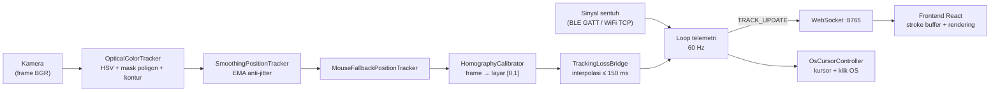

# SPIDOL: Penjelasan Teknis

Dokumen ini menjelaskan bagaimana SPIDOL bekerja di balik layar: dari piksel kamera hingga garis di kanvas dan grafik hasil AI. Untuk pengantar dan cara menjalankan, lihat [README](../README.md). Alasan di balik setiap keputusan desain dicatat di [`docs/adr/`](./adr/).

## Daftar Isi

1. [Alur data end-to-end](#1-alur-data-end-to-end)
2. [Pelacakan posisi ujung spidol](#2-pelacakan-posisi-ujung-spidol)
3. [Peredam jitter (anti-jitter)](#3-peredam-jitter-anti-jitter)
4. [Proyeksi frame kamera ke layar](#4-proyeksi-frame-kamera-ke-layar)
5. [Penanganan kehilangan pelacakan](#5-penanganan-kehilangan-pelacakan)
6. [Sinyal sentuh dan kontrol kursor](#6-sinyal-sentuh-dan-kontrol-kursor)
7. [Telemetri real-time lewat WebSocket](#7-telemetri-real-time-lewat-websocket)
8. [Rendering goresan](#8-rendering-goresan)
9. [Pipeline AI](#9-pipeline-ai)
10. [Mesin grafik fungsi](#10-mesin-grafik-fungsi)
11. [Arsitektur perangkat lunak](#11-arsitektur-perangkat-lunak)
12. [Parameter yang dapat disetel](#12-parameter-yang-dapat-disetel)
13. [Catatan rekayasa](#13-catatan-rekayasa)

---

## 1. Alur data end-to-end

Posisi dan sentuhan sengaja dibawa lewat dua jalur yang terpisah, lalu digabung di server.



Urutan pemrosesan per tick (lihat [`server/server_app.py`](../server/server_app.py)): ambil frame, deteksi posisi, terapkan homography bila terkalibrasi dan posisi terdeteksi, jembatani kehilangan sesaat, gabungkan dengan status sentuh, lalu siarkan dan, bila diaktifkan, gerakkan kursor OS.

## 2. Pelacakan posisi ujung spidol

[`OpticalColorTracker`](../server/hal/trackers.py) mencari ujung spidol berwarna pada setiap frame:

1. **Konversi ke HSV** (`cv2.cvtColor`) dan ambang rentang warna dengan `cv2.inRange`. Ruang HSV dipilih karena rona (hue) relatif tahan terhadap perubahan kecerahan dibanding RGB.
2. **Mask poligon area pencarian.** Bila area pelacakan sudah ditentukan (bagian 4), hasil ambang di-AND dengan mask poligon sehingga benda berwarna serupa di luar area tidak pernah terdeteksi. Mask dibuat sekali per kombinasi (area, ukuran frame) lalu disimpan di cache, karena `cv2.fillPoly` tidak gratis.
3. **Kontur terbesar.** `cv2.findContours` (`RETR_EXTERNAL`) lalu kontur dengan luas terbesar dipilih; kontur di bawah luas minimum (default 20 piksel²) dianggap derau.
4. **Centroid dari image moments** (`m10/m00`, `m01/m00`), dinormalisasi ke rentang [0, 1] terhadap ukuran frame. Hasilnya berupa tuple `(x, y, is_detected)`.

**Rentang warna disetel dari foto spidol asli**, bukan tebakan. Default `H 90–120, S 150–255, V 80–150`. Batas bawah saturasi dinaikkan dari 80 ke 150 untuk menolak false positive yang ditemukan saat pengujian langsung: layar TV yang menampilkan konten kebiruan memiliki rona mirip, tetapi jauh lebih pucat (desaturated) dibanding objek padat. Menurut catatan pengukuran di kode, perubahan satu parameter ini memangkas luas deteksi TV sekitar 140 kali sementara luas deteksi spidol hampir tidak berubah. Batas atas nilai (V ≤ 150) menolak cahaya latar layar yang lebih terang dari objek yang disinari biasa.

Tracker juga mendukung **pita HSV kedua** yang di-OR dengan pita pertama, untuk warna yang melingkar di ujung rentang rona OpenCV (misalnya merah di 170–179 dan 0–10).

## 3. Peredam jitter (anti-jitter)

Centroid hasil deteksi secara alami berfluktuasi antar-frame walau spidol diam: kedipan cahaya, artefak kompresi, dan antialiasing tepi blob. [`SmoothingPositionTracker`](../server/hal/smoothing_tracker.py) membungkus tracker mana pun sebagai *decorator* dan menerapkan **exponential moving average**:

```
smoothed = alpha * raw + (1 - alpha) * smoothed_sebelumnya
```

- `alpha` default **0,3**, diatur dengan `--jitter-smoothing`. Nilai kecil berarti lebih halus tetapi lebih tertinggal; `1.0` menonaktifkan penghalusan.
- **Status penghalusan di-reset saat pelacakan hilang.** Setelah spidol terdeteksi kembali, posisi pertama dilaporkan apa adanya, bukan dicampur dengan posisi lama sebelum celah, sehingga tidak ada "tarikan" menuju titik usang.
- Karena berupa decorator, penghalusan tidak terikat pada deteksi warna dan bisa dipasang pada tracker lain.

## 4. Proyeksi frame kamera ke layar

Kamera hampir tidak pernah tegak lurus terhadap layar, sehingga posisi di piksel kamera tidak bisa dipakai langsung sebagai posisi layar. Masalah ini diselesaikan dalam dua langkah.

**a. Memilih area (quad) pada tayangan langsung.** Opsi `--adjust-tracking-region` membuka jendela OpenCV dengan empat titik sudut yang bisa diseret ([`region_picker.py`](../server/vision/region_picker.py), [`region_selector.py`](../server/vision/region_selector.py)). Area berupa **segi empat umum, bukan hanya persegi panjang**, supaya cocok dengan bentuk trapesium layar saat kamera berada di samping. Logika interaksi (seret, konfirmasi dengan Enter/Space, reset dengan Esc) berada di state machine murni tanpa dependensi OpenCV, sehingga dapat diuji tanpa jendela dan kamera. Quad dengan luas hampir nol (rumus *shoelace*) tidak bisa dikonfirmasi.

**b. Homography dari sudut area ke layar.** Empat sudut quad yang dikonfirmasi dipakai sebagai empat titik korespondensi ke sudut persegi satuan:

```
(x_kiri-atas, y_kiri-atas)   → (0, 0)
(x_kanan-atas, y_kanan-atas) → (1, 0)
(x_kanan-bawah, y_kanan-bawah) → (1, 1)
(x_kiri-bawah, y_kiri-bawah) → (0, 1)
```

[`HomographyCalibrator`](../server/vision/homography.py) menghitung matriks 3×3 dengan `cv2.findHomography`, lalu setiap posisi terdeteksi dipetakan dengan `cv2.perspectiveTransform`. Hasilnya, tepi area pelacakan sama dengan tepi layar: menggerakkan spidol ke tepi kiri area berarti "paling kiri" di kanvas dan, dengan `--control-os-cursor`, di layar Windows. Kalibrasi dilakukan sekali per sesi dan tidak disimpan ke disk; kalibrasi ulang tersedia lewat pesan WebSocket `CALIBRATE`.

Dua fungsi area ini bersifat independen tetapi berbagi satu kali pemilihan: membatasi **di mana** warna dicari (bagian 2) dan **meluruskan** koordinat yang ditemukan (bagian ini).

## 5. Penanganan kehilangan pelacakan

Saat menulis, tangan atau pergelangan sering menutupi ujung spidol sesaat. [`TrackingLossBridge`](../server/vision/tracking_loss.py) menjaga goresan tetap utuh:

- Sampel yang hilang **ditahan** dalam buffer selama celah belum melewati ambang (default **150 ms**).
- Bila spidol terdeteksi kembali sebelum ambang, semua sampel tertahan diisi dengan **interpolasi linier** antara titik terakhir yang diketahui dan titik yang baru ditemukan, berdasarkan cap waktu masing-masing sampel, sehingga garis terlihat kontinu.
- Bila celah melebihi ambang, sampel tertahan dilepas sebagai **pen-up** (`is_detected=false`), bukan ditebak melintasi celah panjang.

Satu sampel masuk dapat menghasilkan nol, satu, atau beberapa sampel keluar, sehingga komponen ini sengaja tidak mengimplementasikan antarmuka `BasePositionTracker` yang satu panggilan per frame.

## 6. Sinyal sentuh dan kontrol kursor

Sinyal sentuh (spidol menempel atau tidak) berasal dari **sensor sentuh kapasitif** di ujung spidol yang dibaca ESP32, dan **tidak pernah membawa posisi**. Dua varian transportasi tersedia dengan kontrak yang sama:

- **BLE GATT**: notifikasi karakteristik kustom, dikonsumsi `BleTouchProvider` (pustaka `bleak`), bukan perangkat mouse Bluetooth HID. Alasannya dicatat di [ADR-0001](./adr/0001-ble-touch-signal-is-custom-gatt-not-hid-clicks.md).
- **WiFi/TCP**: ESP32 terhubung ke server dan mengirim baris `1`/`0` pada setiap perubahan status.

Server menerjemahkan sentuhan menjadi aksi mouse:

- [`HardwareClickBridgeTouchProvider`](../server/hal/hardware_click_bridge.py) mengubah tepi naik/turun sentuhan menjadi **press/release klik kiri** sungguhan lewat `pynput`. Dengan begitu spidol dapat berinteraksi dengan elemen UI (slider, tombol) persis seperti mouse, bukan hanya menggambar.
- [`OsCursorController`](../server/hal/os_cursor_controller.py) (opsional, `--control-os-cursor`) memetakan posisi ternormalisasi ke piksel layar sebenarnya dan menggerakkan kursor sistem. Sampel dengan `is_detected=false` diabaikan, dan bila sedang ada klik tertahan, tombol **dilepas** supaya tombol mouse tidak tersangkut hanya karena pelacakan sempat hilang.
- Bila tidak ada posisi terdeteksi, [`MouseFallbackPositionTracker`](../server/hal/mouse_fallback_tracker.py) memakai posisi mouse asli sehingga menggambar dengan mouse tetap berjalan. Ia sengaja tetap melaporkan `is_detected` yang asli, supaya homography dan kontrol kursor tidak memproses posisi palsu.

## 7. Telemetri real-time lewat WebSocket

Server menyiarkan pesan `TRACK_UPDATE` pada **60 Hz** (`asyncio`, port 8765) berisi `x`, `y`, `is_touching`, `is_detected`, dan `fps` terukur:

```json
{ "type": "TRACK_UPDATE", "device_id": "...", "x": 0.42, "y": 0.61,
  "is_touching": true, "is_detected": true, "fps": 59.8 }
```

Pembangunan pesan ([`telemetry.py`](../server/telemetry.py)) adalah fungsi murni, terpisah dari loop siaran dan dari HAL, sehingga ketiganya diuji sendiri-sendiri.

Di sisi frontend ([`useSpidolSocket.js`](../view/src/hooks/useSpidolSocket.js)), aliran 60 pesan per detik **disimpan di `ref`, bukan state React**. Satu `setState` per pesan akan memicu hingga 60 render per detik dan terlihat tersendat; sebagai gantinya kanvas membaca `ref` pada jadwal `requestAnimationFrame`-nya sendiri.

## 8. Rendering goresan

- **Ink digerakkan murni oleh telemetri.** [`strokeBuffer.js`](../view/src/lib/strokeBuffer.js) adalah reducer murni yang mengubah aliran `TRACK_UPDATE` menjadi daftar goresan; tidak ada event pointer browser dalam jalur ini. Setiap goresan membawa alat dan gaya (warna, tebal, garis) yang aktif saat goresan dimulai.
- **Penghalusan garis.** Goresan pena bebas digambar dengan kurva kuadratik melalui titik tengah ([`smoothPath.js`](../view/src/lib/smoothPath.js)): tiap titik menjadi titik kontrol, dan kurva melewati titik tengah setiap pasangan titik berurutan, sehingga sudut membulat alih-alih patah-patah. Bentuk geometris (persegi, elips, garis, panah) tetap tegas, dan penghalusan yang sama dipakai ulang untuk kurva grafik.
- **Penghapus per goresan.** Hit-testing memakai ekspansi segmen setiap alat (`strokeSegments`), sehingga rendering dan penghapusan selalu konsisten untuk semua jenis bentuk.
- **Undo/redo berbasis gestur.** Riwayat mencatat aksi `add`/`erase`; satu seretan penghapus yang menyapu beberapa goresan dibatalkan sebagai satu langkah.
- **Penekan goresan salah sasaran.** Karena sentuhan juga berupa klik OS, menyeret slider akan ikut menggambar di kanvas. [`useDrawSuppression`](../view/src/hooks/useDrawSuppression.js) memakai `pointerdown` untuk menentukan apakah gestur dimulai di kanvas atau di elemen lain; bila di elemen lain, menggambar ditekan selama gestur itu.
- **Mode presentasi.** Kiosk Mode (layar penuh, kursor OS disembunyikan) dan Blackout Mode (tombol `F`, latar hitam pekat) adalah dua konsep terpisah.

## 9. Pipeline AI

Saat tombol *Analyze drawing* diklik, [`handle_ai_trigger`](../server/ai/trigger.py) menjalankan satu siklus penuh:

1. **AI Trigger Region.** [`StrokeRegionTracker`](../server/ai/stroke_region.py) di server menghitung kotak pembatas (bounding box) semua goresan **sejak trigger atau penghapusan terakhir**, bukan jendela waktu tetap, sehingga jeda di tengah rumus tidak memotong area. Server membangun buffer goresannya sendiri dari aliran telemetri yang memang ia miliki, sehingga tidak ada kontrak tambahan dari frontend.
2. **Batas dicatat sebelum pemanggilan lambat.** Penanda trigger disetel sebelum memanggil model, jadi goresan yang digambar selama menunggu AI masuk ke region berikutnya, bukan hilang.
3. **Crop.** Area dipotong dari frame dengan margin 3% supaya tepi goresan tidak terpotong, lalu dienkode PNG ([`crop.py`](../server/ai/crop.py)).
4. **Model vision.** Klien kompatibel OpenAI ([ADR-0005](./adr/0005-openai-compatible-vision-client-not-google-genai.md)) mengirim gambar dan meminta keluaran berupa satu objek JSON dengan skema tetap, yang divalidasi dengan Pydantic. Penyedia dapat diganti lewat `AI_BASE_URL`/`AI_MODEL` tanpa mengubah kode pipeline. Pemanggilan dibatasi waktu (default 3 detik).
5. **Dispatch.** Hasil dikirim sebagai `AI_WIDGET_SPAWN` (jenis didukung) atau `AI_WIDGET_UNSUPPORTED` ([`dispatch.py`](../server/ai/dispatch.py)).

Hal teknis lain yang perlu diketahui:

- **Prompt mengajarkan uji garis vertikal.** Model diminta memilih representasi eksplisit `y = f(x)` bila setiap `x` punya paling banyak satu `y`, atau representasi parametrik `x(t)`, `y(t)` bila tidak (lingkaran, elips). Rumus implisit seperti `2y = 3x` harus diselesaikan ke bentuk `y = ...` lebih dulu.
- **Integral tentu.** Bila rumus tulisan tangan adalah integral tentu dengan batas numerik, model mengembalikan integran beserta `integral_lower`/`integral_upper`, dan tidak boleh mengarang batas yang tidak tertulis.
- **Papan kosong tidak memanggil API.** Bila tidak ada goresan sejak trigger terakhir, pemanggilan model dilewati sama sekali (tanpa crop dan tanpa token terpakai).

## 10. Mesin grafik fungsi

Frontend menampilkan hasil AI lewat [`functionGraph.js`](../view/src/lib/functionGraph.js) dan [`SimulationWidget.jsx`](../view/src/components/SimulationWidget.jsx):

- **Evaluasi aman.** Ekspresi dari AI dikompilasi dengan `mathjs/number`, **tidak pernah `eval()` atau `new Function()`**, sehingga ekspresi yang rusak atau berbahaya hanya bisa gagal parse, tidak bisa menjalankan kode. Varian `mathjs/number` dipakai karena tanpa BigNumber/Fraction/Complex yang tidak dibutuhkan, sehingga ukuran bundel jauh lebih kecil.
- **Sampling tahan domain.** Fungsi dicuplik pada 200 titik (parametrik 300 titik). Titik yang melempar galat atau bernilai tak hingga (mis. akar bilangan negatif, log nol) **dilewati**, jadi celah di kurva adalah rendering yang benar, bukan bug.
- **Autoscale.** Viewport dipilih dari data dengan padding 15%, bukan rentang tetap, sehingga `y = x²` pada `x ∈ [-10, 10]` tidak terpotong.
- **Sumbu dan slider "rapi".** Tick sumbu dan langkah slider dipilih dari kelipatan 1/2/5 × 10ⁿ ([`axisTicks.js`](../view/src/lib/axisTicks.js), [`niceStep.js`](../view/src/lib/niceStep.js)) dengan pembulatan yang meniadakan derau floating-point, sehingga slider tidak melompat antara nilai bulat dan nilai berekor panjang.
- **Pan dan zoom** ([`graphViewport.js`](../view/src/lib/graphViewport.js)). Zoom mempertahankan titik di bawah kursor (zoom ke arah kursor, bukan ke tengah) dengan batas rentang minimum dan maksimum. Pan memakai aliran `TRACK_UPDATE` yang sama dengan penggambaran, sehingga bekerja identik untuk mouse dan spidol. Karena spidol tidak punya roda gulir, **ketuk dua kali** (dalam 400 ms dan 30 piksel) menjadi gestur zoom.
- **Integral tentu.** Nilai dihitung dengan **aturan trapesium komposit** pada 400 subinterval, dan area di bawah kurva diarsir di antara kedua batas. Sampel yang tidak valid dihitung nol, bukan menjadikan seluruh hasil NaN.
- **Fondasi simulasi fisika.** Integrator RK4 untuk pegas-massa, bandul (nonlinier penuh, bukan aproksimasi sudut kecil), dan gerak peluru sudah ditulis di [`rk4.js`](../view/src/lib/rk4.js) tanpa pustaka fisika ([ADR-0004](./adr/0004-v1-scope-single-stylus-no-aruco.md), [ADR-0006](./adr/0006-function-graph-is-generative-the-others-arent.md)).

## 11. Arsitektur perangkat lunak

- **Hardware Abstraction Layer.** Loop telemetri hanya bergantung pada tiga kontrak abstrak, `BasePositionTracker`, `BaseTouchProvider`, dan `BaseImageSource` ([`hal/interfaces.py`](../server/hal/interfaces.py)), tidak pernah pada kelas konkret. Driver baru dapat dipasang tanpa menyentuh loop (prinsip Open-Closed).
- **Decorator untuk urusan lintas komponen.** Penghalusan, fallback mouse, dan pratinjau debug masing-masing membungkus tracker dan tetap transparan bagi pemanggil.
- **Inti murni, cangkang I/O tipis.** Logika yang dapat diuji (state machine pemilih area, reducer goresan, perhitungan homography, jembatan kehilangan pelacakan) dipisahkan dari I/O sungguhan (jendela OpenCV, BLE, kamera). Seam yang dapat disuntik (`capture_factory`, `client_factory`, `show_frame`) memungkinkan uji tanpa perangkat keras.
- **Tiga bagian terpisah.** `spidol/` (firmware), `server/` (visi dan AI), dan `view/` (antarmuka) dapat dikembangkan dan diuji sendiri-sendiri.
- **Pengujian.** Lebih dari 350 uji otomatis (Python dengan `pytest`, frontend dengan `vitest`; jumlah dihitung dari definisi uji) mencakup tracker, homography, penjembatan kehilangan, penghalusan, penyedia sentuh, pipeline AI, dan pustaka frontend.

## 12. Parameter yang dapat disetel

| Parameter | Lokasi | Default | Fungsi |
|---|---|---|---|
| `--jitter-smoothing` | CLI server | `0.3` | Faktor EMA anti-jitter; `1.0` menonaktifkan |
| `--tracker` | CLI server | mouse | `optical-color` untuk kamera |
| `--camera-url` / `--camera-index` | CLI server | indeks 0 | Sumber kamera (HTTP atau perangkat) |
| `--flip-camera` | CLI server | mati | Cerminkan frame (webcam PC menghadap pengguna) |
| `--adjust-tracking-region` | CLI server | mati | Pilih quad area pelacakan sekali per sesi |
| `--control-os-cursor` | CLI server | mati | Kursor dan klik OS mengikuti spidol |
| `--debug-camera` | CLI server | mati | Jendela deteksi dengan label `DETECTED`/`NO TARGET` |
| `AI_API_KEY`, `AI_BASE_URL`, `AI_MODEL` | `server/.env` | Gemini | Kunci dan penyedia model vision |
| `AI_TIMEOUT_S` | `server/.env` | `3.0` | Batas waktu pemanggilan model |
| Rentang HSV | konstruktor `OpticalColorTracker` | `H 90–120, S 150–255, V 80–150` | Warna ujung spidol |
| Ambang kehilangan | konstruktor `TrackingLossBridge` | `0.15` s | Batas interpolasi sebelum pen-up |
| Port | `main.py` | `8765` (WS), `5000` (statis), `5173` (dev) | |

## 13. Catatan rekayasa

- Rentang HSV default disetel untuk marker berwarna toska dan bergantung pada pencahayaan. Warna lain dapat diatur lewat `hsv_lower`/`hsv_upper` (dan pita kedua untuk merah).
- Pengukuran latensi ujung ke ujung dengan kamera ponsel belum dilakukan, sehingga dokumen ini tidak mencantumkan angka latensi.
- Kalibrasi homography bersifat manual dan sekali per sesi; deteksi pergeseran kamera otomatis tidak ada.
